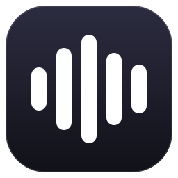
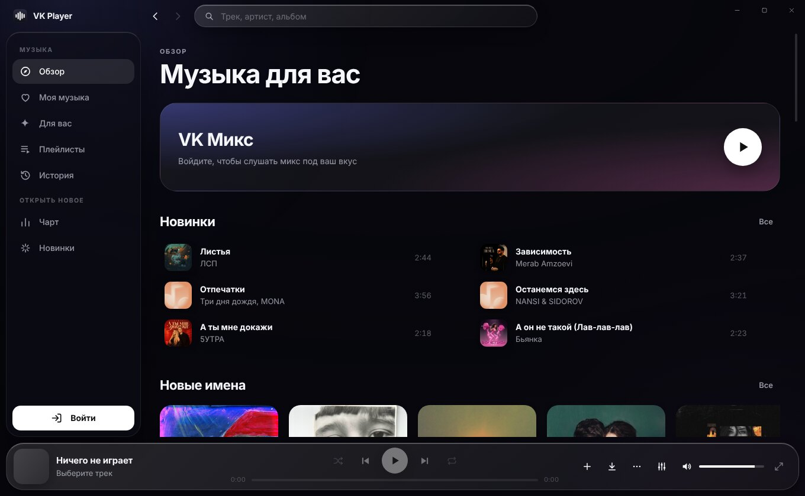
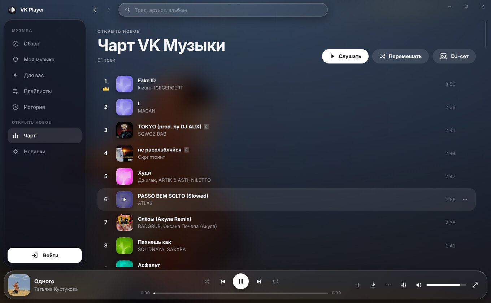
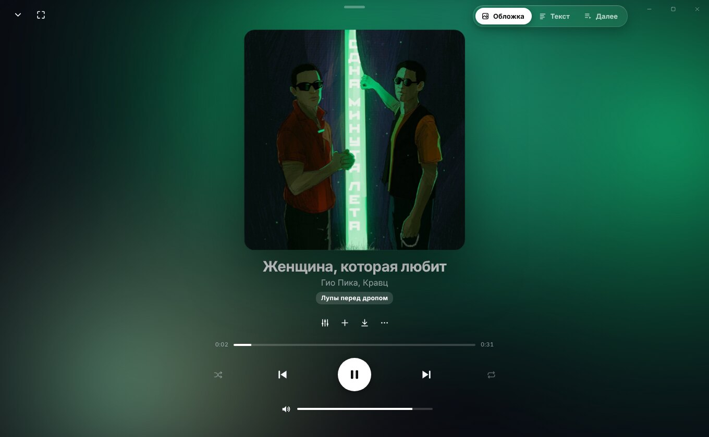
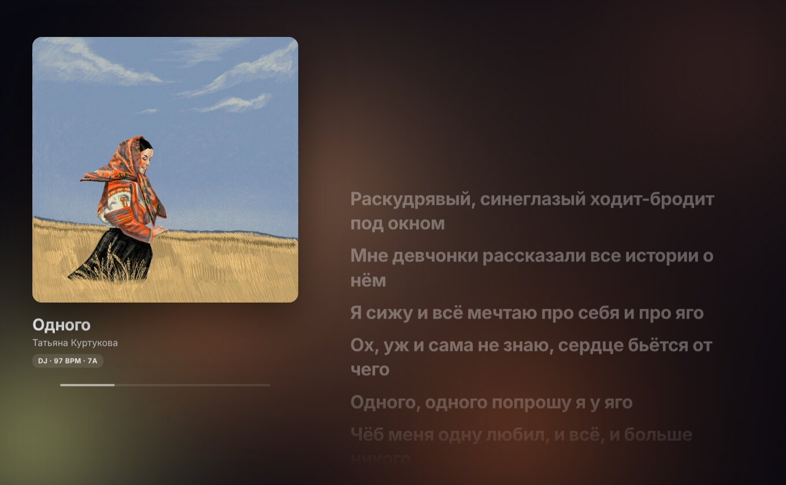
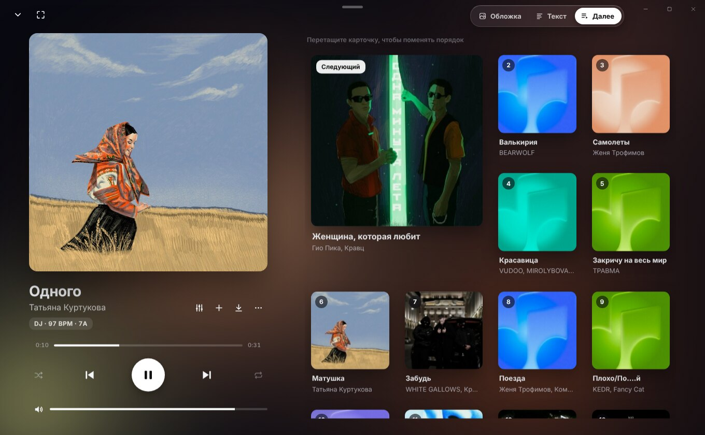
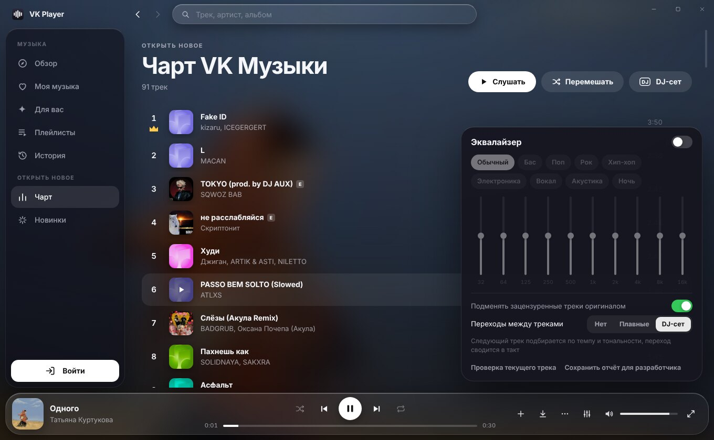

<div align="center">



# VK Player

**Десктопный плеер ВК Музыки для Windows: свой интерфейс, DJ-сеты и музыка без цензуры**

[](https://github.com/rex1do/vk/releases/latest)
[](https://github.com/rex1do/vk/actions)

</div>



VK Player — плеер ВК Музыки со своим интерфейсом в стиле «жидкого стекла»: живой фон из цветов обложки,
полупрозрачные панели, плавные анимации. Он сводит треки как диджей (подбирает следующий по темпу и
тональности, переходит в такт), сам находит и включает версии песен без цензуры, показывает тексты
с подсветкой строки и обновляется автоматически.

## Скачать

Страница **[последнего релиза](https://github.com/rex1do/vk/releases/latest)**:

| Файл | Что это |
|---|---|
| `VKPlayer-Setup-x.y.z.exe` | Установщик. Сам проверяет обновления при запуске, скачивает их в фоне и предлагает перезапуститься |
| `VKPlayer-Portable-x.y.z.exe` | Без установки. О новой версии сообщает и открывает страницу загрузки |

Windows 10 и 11, 64 бита. Каждая сборка из ветки `main` публикуется как релиз автоматически.

## Возможности

### 🎧 DJ-сет

| Кнопка «DJ-сет» у альбомов, плейлистов и чарта | Переход в полноэкранном плеере |
|---|---|
|  |  |

Треки сводятся, как на диджейском сете, в духе AutoMix из Apple Music:

- **Подбор следующего трека.** Приложение в фоне разбирает ближайшие треки: темп (BPM), сетку долей,
  тональность по кругу Камелота (8A, 9B…) и громкость. Следующим ставится трек с близким темпом и
  совместимой тональностью.
- **Переход в удачный момент.** Текущий трек уходит на границе музыкальной фразы перед аутро.
  Следующий подкладывается так, что конец его вступления приходится ровно на этот момент:
  затянутые концовки и вступления не слушаешь целиком.
- **Сведение в такт.** Темп нового трека подгоняется под текущий без изменения тона, доли держатся
  вместе с точностью до миллисекунд, потом темп незаметно, примерно за минуту, возвращается к родному.
- **Шесть стилей переходов.** Выбираются по ситуации и не повторяются подряд:

  | Темпы свелись | Темпы слишком разные |
  |---|---|
  | **Сведение в такт** — новый трек входит без баса, на сильной доле забирает бас, старый уходит фильтром, эхом и ревербератором | **Эхо-переход** — старый разгоняется фильтром, последняя доля уходит в эхо, новый вступает точно в долю |
  | **Фильтр-сведение** — старый трек «уходит под воду», к дропу нового нарастает шипящий райзер | **Виниловый стоп** — старый трек «тормозят рукой», как пластинку, и в долю вступает новый |
  | **Лупы перед дропом** — старый трек дробится на полдоли и четверть доли, на сильной доле взрывается новый | **Смыв ревербератором** — старый тонет в «зале», новый поднимается из этой волны |

- **Звучит как одно целое.** Все треки выравниваются по громкости, на общем выходе работает
  лёгкая «склейка», как при сведении микса, и мягкий лимитер.

Как включить:

- **«DJ-микс»** у «Моих треков» — вся медиатека с подбором треков по темпу и тональности;
- **«DJ-сет»** рядом со «Слушать» у альбомов, плейлистов и чарта — треки идут по порядку, но со сведением;
- **«Переходы → DJ-сет»** в панели эквалайзера — для любой очереди, в том числе для VK Микса.

### 🔞 Без цензуры

Если лицензионный трек зацензурен, плеер сам находит копию без цензуры, загруженную во ВКонтакте,
и на той же секунде переключается на неё. Копии проверяются по самой звуковой волне: подходит только
та же запись, которая совпадает везде, кроме мест цензуры. Ремиксы, slowed, «биты без вокала»,
рок-версии и мешапы отсекаются. Все найденные версии видны в окне проверки, любую можно включить вручную.

### 🎤 Тексты песен

| Текст с подсветкой строки | Очередь «Далее» карточками |
|---|---|
|  |  |

Тексты берутся из ВКонтакте, затем из открытой базы LRCLIB (часто с привязкой ко времени), затем с Genius.
Текущая строка подсвечивается, клик по строке перематывает трек к ней.

### 🖥 Полноэкранный плеер

- три вида: **«Обложка»**, **«Текст»**, **«Далее»** (очередь карточками, их можно перетаскивать);
- живой фон из цветов обложки;
- через 5 секунд без движения мыши кнопки прячутся, а обложка плавно увеличивается;
- жесты на обложке: колесо — громкость, потянуть вбок — перемотка, вниз — свернуть, двойной клик — в «Мои аудио»;
- режим «только плеер» на весь экран (⛶ или `F11`).

### 🎵 Музыка

- **VK Микс** с настройками: настроение, узнаваемость (знакомое, незнакомое, новинки), язык;
- **Чарт VK Музыки** с местами и движением треков, **Новинки**, **Для вас**, **Плейлисты**,
  страницы артистов с релизами (с пометкой: сингл, EP или альбом);
- **поиск** с подсказками артистов и треков;
- **«Мои аудио»**: добавить, удалить, перемешать всю медиатеку сразу;
- **история прослушиваний**;
- **скачать трек** в MP3 с названием, исполнителем и обложкой.

### ⚙️ Плеер



- **переходы между треками**: нет, плавные (кроссфейд, длительность настраивается) или DJ-сет;
- **эквалайзер** на 10 полос с пресетами;
- музыка не прерывается при переходах между разделами; при сбое сети плеер сам переподключается
  и продолжает с той же секунды;
- трей (крестик сворачивает, музыка играет), медиаклавиши, системная плашка Windows;
- учитываются системные настройки «уменьшить анимацию» и «уменьшить прозрачность».

## Горячие клавиши

| Клавиши | Действие |
|---|---|
| `Пробел` | Играть / пауза |
| `←` `→` | Перемотка на 5 секунд |
| `Alt+←` `Alt+→` | Назад / вперёд по разделам |
| `Ctrl+F` | Поиск |
| `F11` | Плеер на весь экран |
| `Esc` | Закрыть окно или свернуть полноэкранный плеер |
| `Ctrl+W` | Свернуть в трей |
| `Ctrl+Q` | Выход |

## Безопасность аккаунта

- **Вход** — только на официальной странице ВКонтакте, она показывается внутри окна на время входа.
- **Данные** приходят через API веб-версии ВК (`web.api.vk.ru`, клиент самого сайта vk.com). Запросы
  выполняются внутри невидимой официальной страницы vk.com с её же токеном: для ВК это ровно те же
  запросы, что делает сайт.
- **Чего нет:** неофициальных клиентов и чужих токенов (Kate Mobile и т. п.), за которые ВК
  замораживает аккаунты. Плеер не открывает других разделов ВКонтакте: это только музыка.

Без входа доступны обзор, чарт и новинки (ВК даёт 30-секундные фрагменты). Поиск, «Моя музыка»,
«Для вас», VK Микс и плейлисты доступны после входа.

## Если что-то не так

В панели эквалайзера есть кнопка **«Сохранить отчёт для разработчика»**. Она сохраняет в «Загрузки»
файл с журналом: поиск версий без цензуры, DJ-переходы, ошибки сети. Токены и ссылки в отчёт не попадают.

## Разработка

```bash
npm install
npm start          # запустить
npm run dist       # собрать установщик и portable в dist/
```

Electron 38, без фреймворков: интерфейс на чистом HTML, CSS и JavaScript.

| Файл | Что внутри |
|---|---|
| `main.js` | Окно, вход, мост к API ВК, скачивание и расшифровка HLS, тексты (LRCLIB, Genius), обновления |
| `preload-shell.js` | Безопасный мост между интерфейсом и основным процессом |
| `shell/app.js` | Интерфейс, плеер на двух деках, эквалайзер, поиск версий без цензуры, тексты |
| `shell/dj.js` | DJ-режим: подбор треков, план перехода, сведение, стили переходов |
| `shell/dj-worker.js` | Анализ звука в отдельном потоке: темп, доли, сильные доли, тональность, громкость |
| `shell/compare.js` | Сравнение звуковых волн для поиска версий без цензуры |
| `shell/shell.css`, `shell/index.html` | Вёрстка и стили |
| `.github/workflows/build.yml` | Сборка под Windows и публикация релиза при пуше в `main` |

Чтобы выпустить новую версию, поднимите `version` в `package.json` (и в `package-lock.json`)
и запушьте в `main`: сборка создаст релиз, а установленные копии обновятся сами.

Дизайн-принципы лежат в `.claude/skills/apple-design` (скилл Эмиля Ковальски, MIT).
